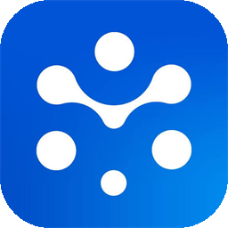

   
  Acesso remoto da Hage

  <a href="#download">Download</a> •
  <a href="#gerar-uma-nova-versão">Gerar nova versão</a> •
  <a href="#atualizar-com-o-rustdesk">Atualizar</a> •
  <a href="#licença-e-créditos">Licença</a>

# HageDesk

O **HageDesk** é o aplicativo de acesso remoto da Hage. Ele é baseado no [RustDesk](https://github.com/rustdesk/rustdesk), com o nome e a identidade visual da Hage, e mantém todos os recursos do original: controle remoto, transferência de arquivos, chat, gravação de sessão e acesso não assistido.

## Download

| Arquivo | Uso |
|---|---|
| [**hagedesk-1.5.1-x86_64.msi**](https://github.com/Pir4s/rustdesk/releases/download/hagedesk/hagedesk-1.5.1-x86_64.msi) | Instalador para Windows (recomendado) |
| [**hagedesk-1.5.1-x86_64.exe**](https://github.com/Pir4s/rustdesk/releases/download/hagedesk/hagedesk-1.5.1-x86_64.exe) | Executável que roda sem instalar |

Todas as versões ficam em [Releases](https://github.com/Pir4s/rustdesk/releases/tag/hagedesk).

> [!Note]
> O instalador ainda não tem assinatura digital, então o Windows pode exibir o aviso **"O Windows protegeu o computador"**. Clique em **Mais informações → Executar assim mesmo**.

## Gerar uma nova versão

O instalador é compilado pelo GitHub Actions. Não é preciso instalar nada no computador.

1. Abra [Actions → Flutter Nightly Build](https://github.com/Pir4s/rustdesk/actions/workflows/flutter-nightly.yml).
2. Clique em **Run workflow**, escolha a branch `master` ou `hagedesk` e confirme.
3. Aguarde de 30 a 60 minutos. O instalador novo aparece em [Releases → hagedesk](https://github.com/Pir4s/rustdesk/releases/tag/hagedesk).

O build gera apenas a versão para **Windows x64** (workflow [`hagedesk-windows.yml`](.github/workflows/hagedesk-windows.yml)).

## O que foi personalizado

| Item | Arquivos |
|---|---|
| Nome do app (`HageDesk`) | `src/common.rs` (`BRAND_APP_NAME`) |
| Dados do executável no Windows | `Cargo.toml`, `flutter/windows/runner/Runner.rc`, `flutter/windows/runner/main.cpp` |
| Ícones e logo | `res/*.png`, `res/*.ico`, `flutter/assets/icon.*`, `flutter/assets/logo.png`, `flutter/windows/runner/resources/app_icon.ico` |
| Instalador MSI | `res/msi/preprocess.py`, `.github/workflows/flutter-build.yml` |
| Build rápido | `.github/workflows/hagedesk-windows.yml`, `.github/workflows/flutter-nightly.yml` |

## Atualizar com o RustDesk

Este repositório **não se atualiza sozinho** quando sai uma versão nova do RustDesk. Para atualizar, traga as mudanças do repositório original, resolva os conflitos com os arquivos da tabela acima e gere uma nova versão.

> [!Warning]
> Não use a opção **Sync fork → Discard commits** do GitHub. Ela apaga as personalizações do HageDesk.

## Licença e créditos

O HageDesk é derivado do [RustDesk](https://github.com/rustdesk/rustdesk), © Purslane Tech Pte. Ltd. e colaboradores, distribuído sob a licença [GNU AGPL-3.0](LICENCE). O código-fonte do HageDesk, incluindo as modificações, está disponível neste repositório, sob a mesma licença.

A documentação original do RustDesk está em [docs/README-RustDesk.md](docs/README-RustDesk.md).

> [!Caution]
> Use o HageDesk somente para acessar computadores com autorização do responsável. Acessos não autorizados são proibidos.
